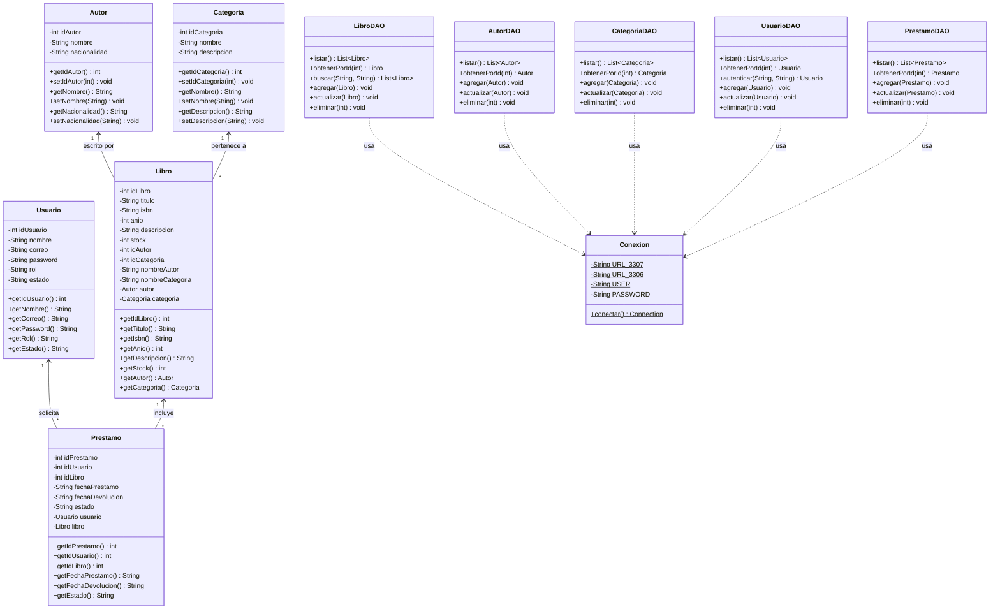

# 📚 BOOKHUB — Sistema Web de Gestión de Biblioteca Universitaria

Aplicación web desarrollada en **Java (Jakarta EE / Servlets / JSP / MVC / DAO con JDBC y MySQL)** manteniendo la estructura original de proyecto **NetBeans / Apache Ant (`build.xml`, `nbproject/`)**, configurada para **Apache Tomcat 10** y **JDK 24**.

---

## ♿ ODS 09: Innovación Tecnológica para Personas con Discapacidad

En cumplimiento con el **ODS 09 (Industria, Innovación e Infraestructura - Metas 9.c y 9.1)** y las pautas internacionales de accesibilidad web **WCAG 2.1 (Nivel AAA)**, **BOOKHUB** integra un ecosistema de **tecnologías de asistencia e inclusión digital**, garantizando que estudiantes y lectores con discapacidad visual, auditiva, física/motriz o neurodivergencia accedan a los recursos bibliográficos en igualdad de condiciones:

1. **🔊 Síntesis de Voz y Audiolibro Asistido (Text-to-Speech):**
   - Cobertura del **100% de los libros** del catálogo y fichas de detalle con lectura en voz alta en español mediante la **Web Speech Synthesis API**.
   - Control interactivo de reproducción (Iniciar, Pausar, Reanudar, Detener) y selector de velocidad (0.8x lenta, 1.0x normal, 1.2x rápida) para personas con baja visión, debilidad visual o ceguera.

2. **🎙️ Búsqueda Manos Libres por Reconocimiento de Voz (Speech-to-Text):**
   - Sistema de búsqueda integrado en la barra de navegación y catálogo mediante la **Web Speech Recognition API**.
   - Permite consultar libros y autores simplemente dictando la consulta al micrófono, ideal para usuarios con discapacidad motriz en extremidades superiores o artritis.

3. **🌓 Modos de Visión y Alto Contraste Adaptativo (Baja Visión & Daltonismo):**
   - **Modo Alto Contraste (WCAG AAA):** Fondo negro (`#000000`) con tipografía en amarillo de alto contraste (`#ffff00`) y bordes cian.
   - **Modo Monocromático:** Escala de grises pura para personas con acromatopsia o daltonismo extremo.
   - **Modo Oscuro Suave:** Reducción de fatiga visual y fotofobia.
   - **Escalador Dinámico de Fuente (A- / A / A+):** Ajuste del tamaño de texto sin romper la interfaz responsive.

4. **🧠 Accesibilidad Cognitiva, Dislexia y TDAH:**
   - **Modo Tipografía para Dislexia:** Aplica pesos basales reforzados, interletrado (`letter-spacing: 0.06em`), interpalabra (`word-spacing: 0.12em`) e interlineado amplio (`line-height: 1.8`).
   - **Regla Visual de Lectura Guiada:** Línea guía horizontal translúcida que sigue el cursor del mouse para evitar la pérdida de renglón en lectores con TDAH o dificultades de fijación ocular.
   - **Navegación Asistida por Teclado:** Foco visual de alta visibilidad para navegación 100% mediante tecla Tabulador.

5. **🧪 Centro de Innovación y Laboratorio ODS 09 (`innovacion.jsp`):**
   - Apartado interactivo donde cualquier usuario o evaluador puede experimentar en tiempo real con el simulador de síntesis de voz, dictado manos libres, pruebas de daltonismo y monitoreo de recursos bibliográficos adaptados.
   - **Widget Flotante Universal (♿ ODS 09):** Presente en todas las vistas con memoria persistente (`localStorage`) que preserva las preferencias de accesibilidad entre sesiones.

---

## 🔑 Usuarios Pre-creados (1 Admin y 2 Lectores)

En la pantalla de **Iniciar sesión (`login.jsp`)** puedes iniciar sesión directamente o usar los botones de autocompletado rápido:

| Rol | Nombre | Correo | Contraseña | Estado |
| :--- | :--- | :--- | :--- | :--- |
| **ADMIN** | Administrador | `admin@bookhub.com` | `123456` | `ACTIVO` |
| **USUARIO (Lector 1)** | Juan Pérez (Lector 1) | `juan@bookhub.com` | `123456` | `ACTIVO` |
| **USUARIO (Lector 2)** | María López (Lector 2) | `maria@bookhub.com` | `123456` | `ACTIVO` |

Además, cualquier nuevo lector puede crear su cuenta desde el apartado **Registrarse (`registro.jsp`)**.

---

## 📐 Diagrama de Clases UML (Entregable 1 y 2 - Evaluación T2 SWAD)



---

## 🗂️ Estructura del Proyecto (NetBeans / Apache Ant)

```text
BookHub/
├── build.xml                        # Script de compilación Apache Ant (NetBeans)
├── nbproject/                       # Configuración de Apache Tomcat 10 y JDK 24
├── database/
│   └── bookhub.sql                  # Script MySQL con tablas y datos semilla
├── src/
│   ├── conf/MANIFEST.MF
│   └── java/
│       ├── beans/                   # Modelo de clases (Autor, Categoria, Libro, Prestamo, Usuario)
│       ├── conexion/                # Clase Conexion JDBC MySQL (puerto 3307 / 3306)
│       ├── dao/                     # Capa DAO con PreparedStatement + respaldo en memoria
│       └── servlets/                # Controladores MVC y filtro de seguridad AdminFilter
└── web/                             # Vistas JSP, index.html y configuración WEB-INF/META-INF
```
