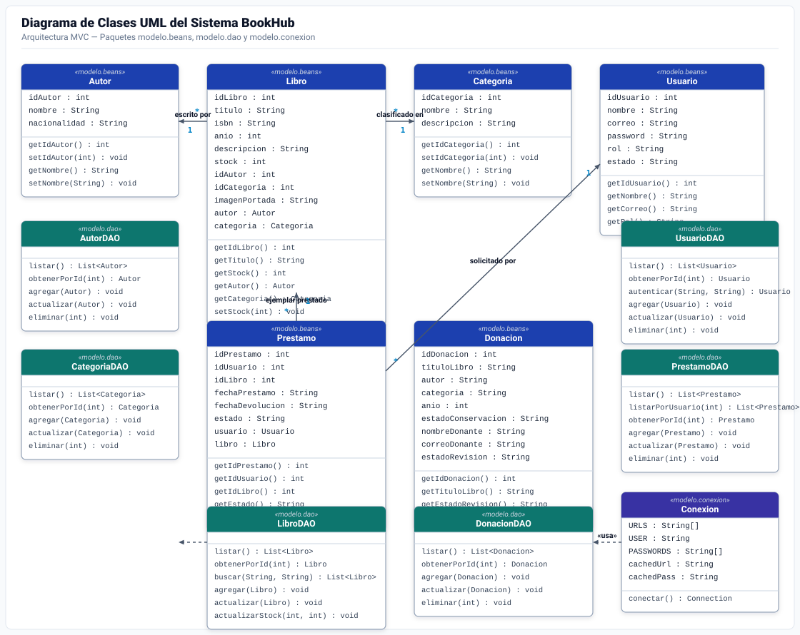
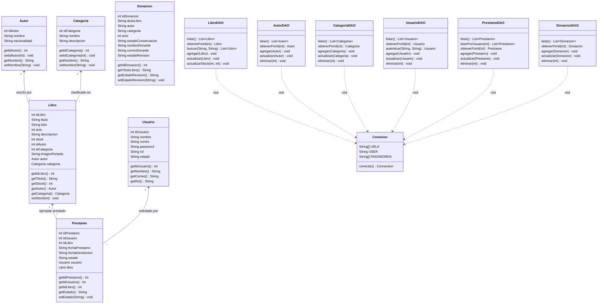
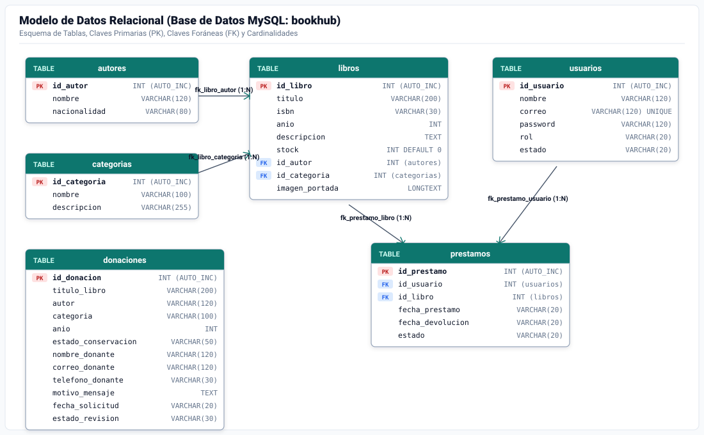
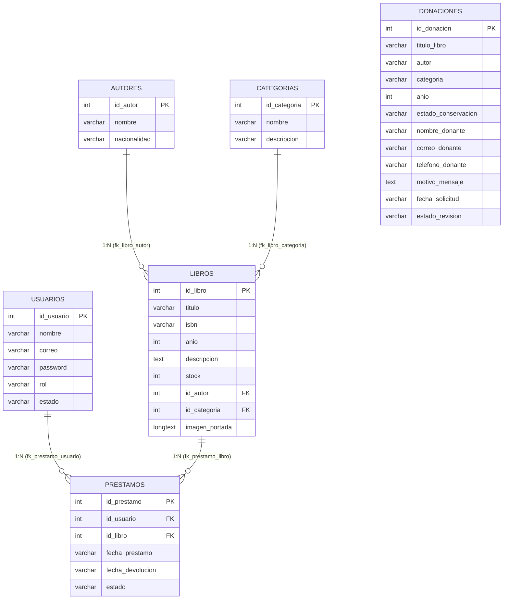

# 📚 BOOKHUB — Sistema Web de Gestión de Biblioteca Universitaria

Aplicación web desarrollada en **Java (Jakarta EE 10 / Servlets 6.0 / JSP / MVC / DAO con JDBC y MySQL)** bajo la arquitectura y estructura estándar de **Apache Maven**, configurada para despliegue en **Apache Tomcat 10+**.

---

## ODS 09: Innovación Tecnológica para Personas con Discapacidad

En cumplimiento con el **ODS 09 (Industria, Innovación e Infraestructura - Metas 9.c y 9.1)** y las directrices internacionales de accesibilidad web **WCAG 2.1 (Nivel AAA)**, **BOOKHUB** integra una suite de **tecnologías de asistencia e inclusión digital**, diseñada para que estudiantes e investigadores con discapacidad visual, motriz o cognitiva accedan al catálogo y contenidos en igualdad de condiciones:

1. **Visualización Directa de Portadas y Carátulas:**
   - Visualización directa de las portadas de los libros en la vista de catálogo (`160px x 224px`) con soporte de texto alternativo (`alt`) estructurado, optimizando la identificación visual inmediata sin depender exclusivamente del modal de vista rápida.

2. **Modos de Contraste Calibrados (Sin pérdida de legibilidad):**
   - **Modo Sepia (Lectura Cálida):** Fondo tono papel (`#fbf0d9`) y texto café oscuro (`#2c221e`), ideal para evitar la fatiga visual en sesiones prolongadas.
   - **Modo Pizarra Oscura:** Fondo gris pizarra (`#0f172a`), tarjetas (`#1e293b`) y tipografía clara (`#cbd5e1`), reduciendo el deslumbramiento.
   - **Modo Alto Contraste (WCAG AAA):** Fondo negro absoluto (`#000000`) con tipografía en blanco puro (`#ffffff`), acentos en amarillo accesible (`#ffff00`) y bordes cian (`#00e5ff`). Todas las clases de texto secundario y atenuado están calibradas para garantizar 100% de visibilidad.

3. **Escala Tipográfica Progresiva (100% a 145%):**
   - Selector escalonado de 4 niveles (`100%`, `115%`, `130%` y `145%`) que redimensiona proporcionalmente la interfaz sin desbordamientos de maquetación, con persistencia en `localStorage`.

4. **Apoyo de Lectura y Neurodivergencia:**
   - **Modo Dislexia:** Aplica pesos basales equilibrados, espaciado entre letras (`letter-spacing: 0.05em`) e interlineado ampliado (`line-height: 1.85`).
   - **Máscara de Foco de Lectura:** Guía visual de lectura que atenúa el fondo y proyecta una franja iluminada siguiendo el cursor del ratón, facilitando la concentración en lectores con TDAH o dificultades de fijación ocular.
   - **Subrayado de Enlaces:** Resaltado explícito con subrayado de alto contraste para identificar elementos accionables sin depender únicamente del color.

5. **Síntesis de Voz y Búsqueda por Reconocimiento de Voz:**
   - **Audiolibro Asistido (Text-to-Speech):** Síntesis de voz en español para títulos, fichas bibliográficas y selección de fragmentos de texto en pantalla mediante la Web Speech Synthesis API, con control de velocidad (0.8x, 1.0x, 1.2x).
   - **Búsqueda Manos Libres:** Integración de la Web Speech Recognition API en la barra de navegación para búsqueda bibliográfica por voz.

6. **Laboratorio de Accesibilidad ODS 09 (`innovacion.jsp`):**
   - Panel de evaluación interactivo donde se comprueba el funcionamiento de las herramientas de asistencia, monitor de recursos adaptados y documentación técnica de cumplimiento.

---

## 🔑 Usuarios Pre-creados (1 Admin y 2 Lectores)

En la pantalla de **Iniciar sesión (`login.jsp`)** puedes iniciar sesión directamente o usar los botones de autocompletado rápido:

| Rol | Nombre | Correo | Contraseña | Estado |
| :--- | :--- | :--- | :--- | :--- |
| **ADMIN** | Administrador | `admin@bookhub.com` | `123456` | `ACTIVO` |
| **USUARIO (Lector 1)** | Juan Pérez (Lector 1) | `juan@bookhub.com` | `123456` | `ACTIVO` |
| **USUARIO (Lector 2)** | María López (Lector 2) | `maria@bookhub.com` | `123456` | `ACTIVO` |

Además, cualquier nuevo lector puede crear su cuenta desde el apartado **Registrarse (`registro.jsp`)**.

---

## 📐 Diagrama de Clases UML y Modelo de Datos

A continuación se presentan los dos diagramas oficiales del sistema, separados en imágenes de alta resolución independientes y con una notación limpia y profesional (sin la presencia de símbolos `+` o `-`):

---

### 1. Diagrama de Clases UML del Sistema
Representa la arquitectura de software en capas (**Modelo de Dominio / Beans**, **Acceso a Datos DAO** y **Conectividad JDBC**), detallando las entidades del sistema, sus atributos, métodos y relaciones de asociación y dependencia.





---

### 2. Modelo de Datos (Base de Datos Relacional MySQL: `bookhub`)
Representa la estructura física y relacional de la base de datos `bookhub`, con sus 6 tablas, claves primarias (`PK`), claves foráneas (`FK`), tipos de datos y cardinalidades `1:N`.





---

## 🏛️ Arquitectura MVC (Modelo - Vista - Controlador)

El sistema implementa estrictamente el patrón arquitectural **MVC (Model - View - Controller)** dividiendo responsabilidades de forma desacoplada:

| Componente MVC | Paquete / Directorio | Responsabilidad Técnica |
| :--- | :--- | :--- |
| **MODELO (M)** | `modelo.beans` | Entidades y objetos de transferencia de datos POJO (`Autor`, `Categoria`, `Donacion`, `Libro`, `Prestamo`, `Usuario`). |
| **MODELO (M)** | `modelo.dao` | Capa de persistencia y operaciones CRUD con `PreparedStatement` hacia MySQL (`*DAO.java`). |
| **MODELO (M)** | `modelo.conexion` | Gestión de conectividad JDBC hacia la base de datos MySQL multiescucha (`Conexion.java`). |
| **VISTA (V)** | `src/main/webapp/` | Interfaz gráfica de usuario mediante páginas JSP (`*.jsp`) con componentes inclusivos WCAG AAA y Bootstrap 5. |
| **CONTROLADOR (C)** | `controlador` | Servlets HTTP (`*Servlet.java`) que reciben peticiones del cliente, coordinan con el Modelo y despachan a la Vista, además del filtro `AdminFilter`. |

---

## 🗂️ Estructura del Proyecto (Apache Maven Standard Layout)

```text
BookHub/
├── pom.xml                          # Configuración Maven (Jakarta EE 10, MySQL Connector 8.4.0)
├── database/
│   └── bookhub.sql                  # Script MySQL con esquema y datos semilla
└── src/
    └── main/
        ├── java/
        │   ├── modelo/              # MODELO (M)
        │   │   ├── beans/           # Entidades de dominio (Autor, Categoria, Donacion, Libro, Prestamo, Usuario)
        │   │   ├── conexion/        # Conexión JDBC MySQL multiescucha (puertos 3306 / 3307)
        │   │   └── dao/             # Acceso a Datos DAO con PreparedStatement
        │   └── controlador/         # CONTROLADOR (C)
        │       ├── *Servlet.java    # Controladores HTTP (Catalogo, Prestamo, Login, Registro, Reportes, etc.)
        │       └── AdminFilter.java # Filtro perimetral de seguridad para vistas de administrador
        └── webapp/                  # VISTA (V)
            ├── *.jsp                # Vistas dinámicas JSP (WCAG 2.1 AAA, Bootstrap 5)
            ├── img/                 # Logotipo vectorial, portadas de libros y diagramas UML
            ├── favicon.ico / .svg   # Icono oficial de la aplicación
            ├── META-INF/context.xml # Configuración de contexto Tomcat
            └── WEB-INF/web.xml      # Descriptor de despliegue Jakarta EE 6.0
```
